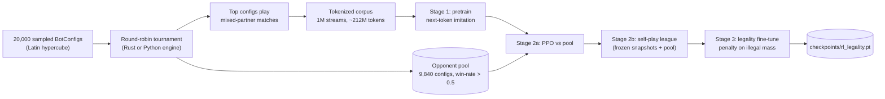

# TrucoGPT

A small (10.2M-parameter) GPT-style transformer that plays **Truco**, the Brazilian 2-vs-2 card game of bluffing, partner signalling and escalating bets. It is trained by imitation, then reinforcement learning, then a legality fine-tune. You can play against it from your terminal or a browser.

The repo contains everything: a pure-Python Truco engine, a bot-tournament framework that generates training data, an optional Rust engine for speed, the training code, the trained model, and the play interfaces.

## Truco in one minute

Truco is played by two teams of two, with partners sitting opposite each other, using a 40-card deck (8s, 9s, 10s and jokers removed). The full rules are in [`docs/TRUCO.md`](docs/TRUCO.md). The short version:

- Each hand, everyone gets 3 cards. The best of three rounds ("tricks") wins the hand. A hand is worth 1 point at first.
- Card strength is unusual (4 is weakest, 3 is strongest). One extra card, the **vira**, is flipped, and the rank just above it becomes the **manilha**, which beats everything. Clubs is the strongest manilha ("zap").
- At any time a player can shout **Truco!** to raise the hand's value to 3. The other side can accept, fold (giving up the points at stake) or re-raise (6, 9, 12). Whether you are bluffing is the heart of the game.
- Partners may send each other secret signals (a wink, a raised eyebrow). The engine models these as discrete signal actions.
- First team to 12 points wins a set. This project plays best-of-3 sets.

## Features

- Pure-Python, I/O-free Truco engine with tests (`truco/`), including signals, face-down cards, and the Hand of Eleven.
- Human-playable terminal interface (`python -m truco`), a stdlib-only "playground" that shows the model's move probabilities and lets you edit the token stream it reads, and a multiplayer web UI (`truco.web`).
- A parameterised, rule-bending bot (`BotConfig`, 14 knobs) used to run large tournaments and produce training data.
- Optional Rust engine (`truco_fast/`, PyO3) for fast tournaments.
- Three-stage training pipeline with shell drivers that reproduce each stage.
- A trained checkpoint in the repo, so `clone -> play` works.

## Requirements

- Python 3.12 or newer and [uv](https://docs.astral.sh/uv/).
- PyTorch (installed by `uv sync`). The checkpoint runs fine on CPU.
- Optional: a Rust toolchain and `maturin` to build `truco_fast`; extra packages for the web UI (below).
- Training from scratch is GPU-oriented. The original run used a single RTX 4080 (see the history doc).

## Quickstart

```bash
git clone https://github.com/rafa-rrayes/trucoGPT.git
cd trucoGPT
uv sync
uv run python -m truco --policy checkpoints/rl_legality.pt   # you (seat 0) + 3 model bots
```

You sit in seat 0 and your partner is seat 2. With `--policy`, your partner and both opponents are the model. Without it, all three are heuristic bots:

```bash
uv run python -m truco                       # play against heuristic bots
uv run python -m truco --policy checkpoints/rl_legality.pt --temperature 1.5   # noisier, sampled play
uv run python -m truco --seed 7 --dealer 2   # reproducible match
```

Other ways to see it play:

```bash
uv run python scripts/web_playground.py                # model-vs-heuristic viewer, http://localhost:8000
uv run python scripts/sim_best_model.py                # narrated model-vs-heuristic matches
uv run python scripts/sim_match.py                     # narrated model vs the #1 opponent-pool config
uv sync --extra web && uv run python -m truco.web      # multiplayer web UI, http://localhost:8000
```

## How the model works

**Architecture.** A decoder-only transformer in the nanoGPT style (`truco/rl/model.py`): `d_model=343`, 7 layers, 7 heads, context length 512, dropout 0.05, **10,219,343 parameters**. The settings live in `truco/rl/config.py`.

**Tokenization.** Each seat gets its own token stream of everything that player is legally allowed to see (`truco/rl/tokenizer.py`, `truco/rl/vocab.py`). The vocabulary has 188 tokens: structural markers (`HAND_START`, `ROUND_END`, `SCORES`, ...), card tokens, numbers, and moves. Everything is **seat-relative** (me / right / partner / left, "us" / "them"), so one model plays any seat. Opponents' hidden cards never appear, and a face-down card played by someone else is a single `PLAY_HIDDEN` token. A decision point is marked by a `TO_ACT` token.

**Policy.** The 94 possible actions (play a card, face-down play, call/raise/accept/fold Truco, Eleven choices, signals) are a contiguous slice of the 188-way next-token head. The policy is that slice, restricted to legal actions by a hard mask. Because of this, next-token pretraining directly warms up the policy. There is also a value head on the shared trunk, used only as an optional PPO baseline.

## Training pipeline



1. **Data generation and imitation pretraining.** There is no external dataset. The "strong tournament play" corpus is generated by this repo: thousands of `BotConfig` bots (the textbook heuristic plus bots that bluff, lie in signals, over-trump, etc.) are sampled and play a round-robin. The top configs then play mixed-partner matches, and every seat's view is tokenized into a corpus. The model is pretrained on it for 20,000 steps at batch size 32 (`python -m truco.rl.pretrain`). Reported validation token accuracy in the history doc: about 0.74.
2. **Reinforcement learning.** Warm-started from the pretrained weights, PPO first trains against the frozen opponent pool (`scripts/train_vs_pool_ppo.py`), then a self-play league (`scripts/train_selfplay.py`) mixes frozen snapshots of the model, pool opponents and the default heuristic.
3. **Legality fine-tune.** The raw (unmasked) policy was found to put about half its probability on illegal moves, with play only legal because of the mask. A short PPO run with an auxiliary penalty on illegal probability mass (`legality_coef=0.5`, 50 iterations, `scripts/train_legality.py`) fixes most of that.

## Results

These numbers come from the checkpoint metadata and from `docs/DEVELOPMENT_HISTORY.md`. They were measured during development and I have not re-run the full evaluations. Win rate is for the model's team (two model seats against two opponent seats), playing greedily with the legal-move mask on.

| Checkpoint | vs opponent pool | vs textbook heuristic | Illegal moves with no mask (greedy) |
|---|---|---|---|
| Self-play champion (before legality fine-tune, not shipped) | 0.730 | 0.660 | 47.9% |
| `rl_legality.pt` (shipped) | 0.690 | 0.668 | 7.6% |

The shipped checkpoint's metadata records `win_rate 0.69`, `win_rate_vs_default 0.668`, `mean_illegal_mass 0.094` and `argmax_illegal_rate 0.0760`. The legality fine-tune cost about 4 points against the pool for a roughly 6x drop in raw illegal moves.

Context for the pool number: the pool is the 9,840 of 20,000 sampled configs that won more than half of their tournament games (20 games each, best-of-3). Its strongest member won 90% of its games, and the textbook heuristic ranked 102nd of 20,000 in that tournament.

Quick check, run while writing this README (`scripts/sim_best_model.py checkpoints/rl_legality.pt 8`): the model won 6 of 8 matches against the textbook heuristic. That sample is far too small to mean much.

**Limitations.**
- Win-rate numbers have sampling error (a few points at the match counts used) and are only against bots built here. There is no evaluation against human players.
- The model still loses a substantial fraction of games to the strongest pool configs.
- Without the legality mask the model still proposes an illegal move about 7.6% of the time. The shipped interfaces always apply the mask.
- Rules are one specific Truco variant (see `docs/TRUCO.md`); regional rules differ.

## Checkpoints

Both files are tracked in git (the model is about 41 MB, under GitHub's 100 MB file limit).

| File | What it is | How to reproduce |
|---|---|---|
| `checkpoints/rl_legality.pt` | The shipped model, 10.2M params: pretrain, then PPO vs pool, then self-play league, then legality fine-tune. | `./run_big.sh` then `./run_legality.sh 50 0.5` |
| `checkpoints/opponent_pool.json` | 9,840 `BotConfig` knob sets (win-rate > 0.5 of 20,000 sampled), with their tournament win rates. Used as RL opponents. Seed 0. | `uv run python scripts/build_opponent_pool.py` |

Intermediate artifacts (`corpus.npz`, about 427 MB, and the pretrain, pool-PPO and self-play checkpoints) are not committed. They are rebuilt by the scripts below.

## Reproduce training

```bash
uv sync
# optional, faster tournaments:
(cd truco_fast && uv run --with maturin maturin develop --release)

./run_big.sh        # corpus -> pretrain -> PPO vs pool -> self-play league
./run_legality.sh 50 0.5   # legality fine-tune (iterations, coefficient) -> checkpoints/rl_legality.pt
```

`run_big.sh` builds a 20,000-config tournament, a 250,000-match mixed-partner corpus, pretrains for 20,000 steps, then runs the PPO and self-play stages. Each stage can also be run alone (`scripts/train_vs_pool_ppo.py`, `scripts/train_selfplay.py`, `scripts/train_legality.py`; see the argument parsing at the top of each). Hyperparameters are in `truco/rl/config.py`. Training is not bit-reproducible: GPU kernels and bot signalling are non-deterministic, so expect results near, not identical to, the numbers above. The full run needs a GPU and several hours.

## Configuration

- CLI flags: `python -m truco --help` (`--policy`, `--temperature`, `--seed`, `--dealer`).
- Web UI: `python -m truco.web --help` (`--port`, `--device`, `--ckpt`, `--ai-delay`, ...). Env vars `TRUCO_WEB_DEVICE`, `TRUCO_WEB_CKPT`, `TRUCO_WEB_AI_DELAY`, `TRUCO_WEB_ROUND_DELAY` are also read. It binds to `0.0.0.0` by default; pass `--host 127.0.0.1` to keep it local.
- Training: `truco/rl/config.py`.

## Project structure

```
truco/
  cards.py state.py engine.py actions.py observation.py   game engine
  env.py                       RL environment wrapper
  agents/                      random, heuristic, configurable (BotConfig), human, policy agents
  cli/                         terminal play loop and renderer
  tournament/                  config sampling, round-robin, corpus generation
  rl/                          tokenizer, vocab, model, pretrain, PPO/REINFORCE, rollout, eval
  web/                         multiplayer FastAPI web UI
truco_fast/                    optional Rust engine (PyO3) for tournaments
scripts/                       training drivers, simulators, web playground
tests/                         unit tests
checkpoints/                   shipped model and opponent pool
docs/                          rules (TRUCO.md), development history
run_big.sh run_selfplay.sh run_legality.sh   pipeline drivers
```

Run the tests with `uv run pytest`.

## Development history

[`docs/DEVELOPMENT_HISTORY.md`](docs/DEVELOPMENT_HISTORY.md) tells the story of how this was built, including dead ends (an MLP policy that plateaued, a policy that depended on the legality mask) and the measurements along the way. The directory was originally called `trucoDQN`, but the method is policy-gradient on a transformer, not DQN.

## License

[MIT](LICENSE)
